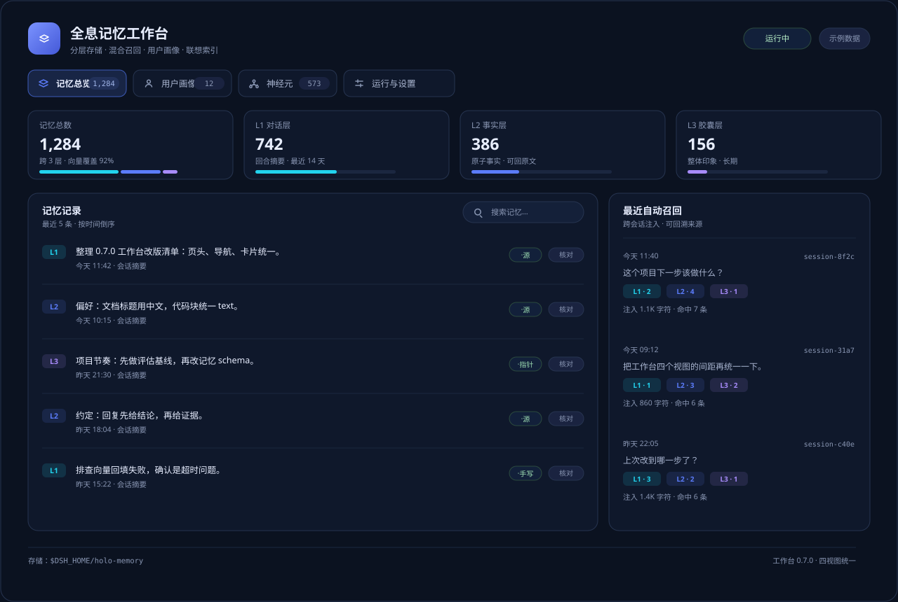

# Changelog

All notable changes to `dsh-holo-memory` are documented here.
Format follows Keep a Changelog; versions follow the package version.

## [1.0.1] - 2026-11-26

**主题：关闭 1.0.0 后续审计 R-01–R-09，并让 Linux CI 真正变绿。**

### Fixed

- **R-01（P0）** 自动抽取的 supersedes 与 `memory_supersede` 共用 `validateSupersedeTargets()`：目标必须存在、同层、同 scope、同 projectKey、active 且在有效期内、无环、无重复；任一非法则整条关系零写入。
- **R-05（P0）** CI 夹具修复：`resolveProjectRoot()` 对不存在的 cwd 不再向上穿越；测试改用临时仓库/子目录，Linux runner 上不再把 `D:\work\...` 当成相对路径折叠到仓库根。neuron 无 lockfile 的 CI 安装步骤改为 `npm install`。
- **R-02** 项目画像的 L1 来源也走 `live()` 时效过滤；过期 L1 不再进入 habits / workingStyle。
- **R-03** 项目键格式约束为 `^p-[0-9a-f]{12}$`（API + 存储层），`ProfileStore` 用 `path.resolve` + `path.relative` 拒绝越出 storageDir 的文件名。
- **R-04** `claim.confidence` 是唯一权威：抽取与 `memory_note` 的顶层 confidence 均由 claim 派生，加载时同样归一；控制台输出 claim 值；`recompute-confidence.mjs` 新增 `--mode raw|calibrated` 并写入实际 `calibrationVersion`。
- **R-06** schema 校验加严：数组元素必须是字符串、`kind` 枚举、scope、时间戳、`confidenceBasis` 字段；隔离失败进入 `store.quarantineFailures`，doctor 新增 `schema:quarantine` 检查。
- **R-07** 迁移脚本映射改为 `{newKey,label,sourceCwds}`，label 正确写入；同一 oldKey 出现多个 newKey 时该 key 中止写入并列入 `skippedConflicts`；新增迁移脚本测试（单项目、幂等、冲突阻断）。
- **R-08** 时间线结果新增 `truncated` / `frontier`，达到 200 节点上限时输出明确提示。
- **R-09** 新增 `eval/regression-manifest.json`（private dataset SHA-256）与 `eval/check-regression.mjs`；文档说明私有回归集的获取与哈希校验方式。

### Verification

```text
holo:   84/84 PASS
neuron: 13/13 PASS
CI:     workflow fixes pushed; see Actions
```

## [1.0.0] - 2026-11-26

**主题：关闭 0.9.0 代码审计的 F-01–F-16，冻结 claim 生命周期、迁移与发布工程。**

### Fixed — P0（1.0 阻断项）

- **F-01** 短输入 `recentFallback()` 现在遵守 `isValidAt()`，并返回结构化 items；注入 id 进入 audit log、buffer 与引用/神经元反馈。
- **F-02** 画像蒸馏统一按 claim 时间过滤；证据全部失效时删除 `a.json` / `a-<projectKey>.json`，不再保留旧结论。
- **F-03** 维护归档与容量 trim 通过 `store.takeRemoved()` + `onRemoved` 传播失效，刷新全部磁盘上的项目画像并同步 neuron。
- **F-04** 新增 `scripts/migrate-project-keys.mjs`：从 L1.cwd 推导旧 key → git 根 key，备份/幂等/未映射报告，不猜测归属。
- **F-05** `memory_supersede` 校验目标存在、层级/scope/projectKey 一致、active 状态、无环；错误 newId 不改任何数据。
- **F-06** 时间线改为图遍历：多父合并、分叉、循环与孤儿全部呈现；条目携带 createdAt/observedAt/recordedAt 与时间来源。
- **F-07** 显式 `supersedes` 不再被近重复合并吞掉：总是创建新 claim 并关闭旧 claim。

### Fixed — P1（正式版前）

- **F-08** 置信度单一权威：`withConfidence` 走校准，`calibrationVersion` 记录实际映射，顶层 `confidence` 由 claim 派生；来源类型表达证据而非 scope。
- **F-09** 字符预算排序改用原始 RRF；`score` 仅层内使用。
- **F-10** 评估指标拆分为 `query` / `resident` / `finalInjected` / `quality` 四组，并记录 dataset/store sha256。
- **F-11** 存储加载按层 schema 校验；坏记录写入 `quarantine/`，合法记录继续加载。
- **F-12** `memory_profile(scope=user|project|both)`；控制台 profile GET/refresh 支持 `scope=project&projectKey=`。
- **F-13** abort 后不再生成 fallback 写入；neuron 延迟同步定时器在卸载时清理。

### Fixed — P2（发布工程）

- **F-14** `package.json` 与 `package-lock.json` 根版本统一为 1.0.0。
- **F-15** 根命令 `npm run test:all` 覆盖 holo + neuron；新增 `.github/workflows/ci.yml`；README 测试数字与 1.0 一致。
- **F-16** npm `files` 白名单加入 `scripts/`，`npm pack --dry-run` 已确认三个迁移脚本随包发布。

### Verification

```text
holo:   74/74 PASS
neuron: 13/13 PASS
npm pack --dry-run: 64 files, scripts/ included
human eval (50 queries, split metrics, vector+neuron+active):
  query  recall@5 0.7645 · hit 0.8387 · quiet 0.6842
  final  expectedCoverage 0.8387
  quality evidence 1.0000 · stale 0.0000 · survival 0.9767
```

## [0.9.0] - 2026-11-26

**主题：把置信度与时间线真正接进记忆使用决策，并收掉索引/画像的陈旧路径。**

### Added

- 置信度进入召回：证据按 `0.9 + 0.2·confidence` 软加权，并在 RRF/词法同分时作为排序 tie-breaker；不设独立通道、不加硬罚分。
  - 实测记录：独立 `confidence` RRF 通道会挤掉更强的相关命中（Recall@5 1.000 → 0.925），已弃用；硬性 `+0.05` 证据罚分会误伤迁移数据（→ 0.613），也已弃用。
- 项目画像：`a-<projectKey>.json`，只收本项目 `scope=project` 的记录；全局画像只收 `scope=user`，**删除了“用户级不足两条就用全部 L2”的回退**。
- `resolveProjectRoot()`：项目标识优先取最近的 `.git` 根，子目录与会话启动目录不再产生不同 projectKey。

### Fixed

- 删除 / 取代后索引与画像立即刷新：`memory_forget`、`memory_supersede`、控制台删除都会触发 `onMutation`（neuron 同步 + 画像刷新）。
- neuron 图只索引 active claim：`readRecords()` 过滤 `status != active` 与旧 `supersededBy`，失效记忆不再通过图边继续激活。
- neuron 同步节流不再直接丢弃：窗口内的调用会安排一次延迟补跑。
- `queryHits` 移到证据闸门之后：弱匹配被闸门挡掉时，Active Window 仍可兜底注入常驻记忆。

### Changed

- 置信度来源化：抽取不再采用模型自报的数字，改用证据来源先验（用户明确 0.950 / 纠正 0.990 / 模型推断 0.550 …）；模型自报值只记入 `extractionQuality`。
- 新增 `scripts/recompute-confidence.mjs`：把旧记录（含迁移数据）按来源先验重算，支持 dry-run 与备份。
- 跨层排序改用原始 RRF；`score` 明确为层内归一化，不再用于跨层比较。

### Verification

```text
holo:   66/66 PASS
human eval (50 queries): recall@5 0.944 · nDCG@5 0.903 · hit rate 1.000 (vector+neuron+active)
confidence recompute: 162 records changed (model self-report -> source prior)
live store: confidence recomputed by source prior (migration_unknown -> 0.500)
```

## [0.8.0] - 2026-11-24

**主题：数值置信度与时间字段（Phase 0–2）。**

### Added

- `ClaimMeta`：`confidence`（0.000–1.000，三位小数）+ `confidenceBasis`（来源、抽取质量、佐证、反证、校验、校准版本）+ `validFrom/validTo/observedAt/recordedAt` + `status/supersedes/supersededBy`。
- `confidence.ts`：`normalizeConfidence()`（clamp / 三位小数 / NaN 安全）、0–1000 整数基点、初始先验表、heuristic-v1 更新式、`shouldAutoApply`（0.700 阈值）。
- `memory_note` 新增可选 `confidence` 参数（默认 0.950，用户明确陈述）。
- 召回行显示 `conf=0.xxx`；低于 0.700 追加 `· 待验证`，可展示但不作为既定事实。
- `eval/`：检索评估骨架（弱标注集、生产等价基线、通道消融、人工标注清单）。
- `scripts/migrate-0.8.mjs`：幂等迁移脚本，默认 dry-run，`--apply` 先备份再写 `schema.json`。
- `memory_recall(asOf=...)`：时间检索，`asOf` 时刻才有效的 claim 才参与召回；过期、未生效、被替代的默认不可见。
- `memory_supersede(oldId, newId?, reason?)`：需求变更时关闭旧 claim（`validTo` = 变更时刻），并把新 claim 挂上 `supersedes`。
- `memory_timeline(id)`：沿 `supersedes / supersededBy` 双向走链，输出「旧 → 新」的有效期与状态。
- 提取提示词支持 `supersedes`：识别「新要求替换旧要求」并自动闭环。
- `src/calibration.ts`：Platt 校准（拟合 / 应用）、Brier、ECE、可靠性曲线；`<store>/calibration.json` 存在时插件启动自动加载。
- `eval/` 增补：真值标注表生成、真值导入、校准拟合脚本（`build-truth-sheet.mjs` / `from-truth.mjs` / `calibrate.mjs`）。

### Changed

- 提取写入的新 L1/L2/L3 记录带 `claim`；`confidence` 全部走归一化。
- 用户纠正（kind=correction）把置信度提到 0.990，并在 `confidenceHistory` 保留旧值。
- 旧记录迁移：L2 保留原置信度并规范化，L1/L3 补 0.500，来源标记 `migration_unknown`。

### Verification

```text
holo:   66/66 PASS
live store: 567 records migrated (l1 403 / l2 159 / l3 5), 0 illegal, 0 drifted
baseline@5 (human labels, 50 queries): 1.000 production-like / 0.950 nDCG@5; no-vector 0.384
neuron: reserved-slot removed + activation-gated evidence (was costing ~8 recall points)
```

## [0.7.0] - 2026-11-24

**主题：A 系列正式更名「用户画像」；全息记忆工作台视觉统一。**

### Changed

- 所有用户可见名称：`A 系列` → `用户画像`（内部 `a.json` / `aSeries*` 保留兼容）。
- 注入块标题改为 `[用户画像 · 偏好/习惯/人格]`。
- 工具描述、系统提示词、控制台、README 统一使用「用户画像」。
- 工作台重构为统一信息架构：
  - 记忆总览
  - 用户画像
  - 神经元
  - 运行与设置
- 统一页头、导航、状态胶囊、卡片、指标、标签、列表、空状态和按钮样式。
- 向量模型配置、运行状态、记忆体检从总览移入「运行与设置」。
- 记忆总览保留指标 + 记忆记录 + 最近自动召回。
- 用户画像页使用统一卡片展示偏好、习惯、人格、工作风格、重要抉择与证据状态。
- 神经元页去掉独立霓虹视觉，改用同一套卡片和指标。
- 增加响应式布局、页脚存储路径与统一状态提示。

### Fixed

- 神经元 Top 实体度数条恢复可见。
- 页头与品牌标识、导航 active 状态、状态胶囊统一对比度。

### Verification

```text
holo:   43/43 PASS
client: node --check PASS
```

生产工作台预览：



> 矢量示意图（示例数据）。仓库自本版本起不发布任何真实截图，避免泄露本机记忆内容。

## [0.6.0] - 2026-11-19

**主题：用户画像 —— 从 L1-L3 蒸馏用户偏好、行为习惯与人格。**

### Added

- **用户画像画像**：独立 `a.json`，从现有 L1/L2/L3 记录蒸馏：
  - `preferences` 喜好偏向；
  - `habits` 行为习惯；
  - `personality` 人格与工作方式；
  - `workingStyle` 高频工作流关键词；
  - `confirmFor` 必须咨询用户的抉择类型；
  - `evidenceIds` 指回原 L1/L2/L3 记录。
- **自动注入**：每轮 L1-L3 召回后追加紧凑的
  `[用户画像 · 偏好/习惯/人格]` 块；即使没有 query 命中，A 画像也可单独注入。
- **决策边界**：A 块与系统提示词同时声明：
  - 低风险、可逆、日常事项默认按偏好执行；
  - 重要、不可逆、付费、公开发布、安全隐私、关系边界等抉择必须先咨询用户。
- **控制台 用户画像页**：查看偏好/习惯/人格/工作方式/边界，支持“重新蒸馏”。
- **工具 `memory_profile(refresh?)`**：读取 A 画像；`refresh=true` 从当前 L1-L3 重建。
- **配置**：`aSeriesEnabled`、`aSeriesMaxChars`、`aSeriesRefreshOnExtract`。
- **画像去重**：按 facet（交付、MOSS、tag 流、肢体、查证、LoRA、语言等）聚类，
  避免同一规则的多种复述占满 A 块。

### Changed

- 控制台视图增加「用户画像」；召回工作步骤 meta 增加 `画像×1` 标记。
- 工具数从 9 增至 10。

### Verification

```text
holo:   43/43 PASS
neuron: 10/10 PASS
client: node --check PASS
```

生产数据预览：L1/L2/L3 全库可蒸馏出偏好 2-5 条、习惯 2-5 条、
人格 1 条与工作风格关键词；证据 id 可逐条 `memory_open` 回源。

## [0.5.6] - 2026-11-19

**主题：修复 0.5.5 引入的工具注册回归，恢复会话与 Agent 预设加载。**

### Root Cause

0.5.5 为读取/写入开关在 `registerTools` 里替换了 **共享 tools 服务** 的
`ctx.tools.register`，且包装器没有返回原始 disposer。后果：

- holo 自己的工具无法被正确卸载；
- 后续注册工具的插件（尤其 `tool-agent-team` 的 per-agent scoped 工具）拿到
  `undefined` disposer；
- Agent 创建/重载时旧工具未正确清理 → `tool "spawn_teammate" is already registered`；
- 清理阶段出现 `TypeError: dispose is not a function`；
- 依赖工具注册的 Agent 预设整体加载失败。

### Fixed

- 删除对全局 `ctx.tools.register` 的 monkey-patch；
- 读取/写入开关改为只控制自动管线：
  - 读关闭：`agent/pre-step` 不注入；
  - 写关闭：`HoloStore` 写闸门拒绝所有 canonical 写入，自动捕获/蒸馏/feedback/
    embedding/neuron sync 全部停止；
- 不再改变其它插件的工具注册行为。

### Verification

```text
holo:   39/39 PASS
neuron: 10/10 PASS
```

测试 profile 重新启用 `tool-agent-team`、holo-memory、neuron-memory 后：
新建工作区会话成功，无 `spawn_teammate` 冲突，无 `dispose is not a function`；
输入框读/写按钮正常出现。

## [0.5.5] - 2026-11-19

**主题：输入框读取/写入双开关。**

### Added

- 在输入框工具行、JSON 剪贴板按钮旁边新增两个按钮：
  - **读**：自动召回读取，默认开；
  - **写**：自动捕获/蒸馏写入，默认开。
- 开关状态由 Host 持有并持久化到 `$DSH_HOME/holo-memory/runtime-toggles.json`；默认
  `{read:true, write:true}`，刷新/重开窗口不丢。
- 新增 `GET/POST /holo-memory/toggles`；POST 需要 `x-holo-memory: 1`。
- 读取关闭：`agent/pre-step` 直接跳过召回；`memory_recall` / `memory_open` /
  `memory_list` / `memory_stats` / `memory_injections` / `memory_doctor` 返回禁用提示；
  模型只看到普通上下文。
- 写入关闭：`HoloStore.insert/update/remove` 统一拒绝；自动捕获、蒸馏、feedback、
  embedding 回填、neuron sync 全部停止；`memory_note` / `memory_forget` /
  非 dry-run `memory_maintenance` 返回禁用提示。
- `dryRun` 维护在写关闭时仍可预览。

### Tests

```text
holo:   39/39 PASS
neuron: 10/10 PASS
```

## [0.5.4] - 2026-11-19

**主题：按全息记忆踩过的坑审计神经元模块，修掉同一类问题。**

### Fixed

- **项目隔离**：memory 节点新增 `projectKey`；holo 自动扩展传入当前 project；
  `expand` 只返回该 project + user-scoped (`''`) 的候选，避免跨项目联想泄漏。
- **查询词重叠过滤**：query 自动扩展的命中必须与候选 label/tags 共享至少一个
  salient query term；显式 `seedIds` 不受此限制。
- **URL 污染**：先从 query 中剥离 URL，再取种子词；避免 `https/com/id/api`
  这类域名片段把 ComfyUI 等无关实体点亮。
- **泛实体种子**：过滤 `--- / 1girl / 2d / thinking / 提示词 / 主人令 / 当前`
  等全局桥词；中文实体最短 3 字符；自动种子上限从 12 降到 8（可配）。
- **配置校验**：`normalizeConfig` 支持 boolean，并 clamp depth/damping/topK/
  maxNodes/maxEdges/maxDegree/maxTags/maxSeedEntities；非法值不再穿透到图算法。
- **maxNodes 清理**：裁掉 memory 节点后重新计算 entity degree 并删除孤儿实体。
- **feedback 清理**：边固定为 memory→entity，移除无效的 `edge.to` memory 判断。
- 新增 `requireQueryOverlap`（默认 `true`）、`maxSeedEntities`（默认 `8`）配置。
- 新增回归测试：项目过滤、query overlap、seed 去泛化、配置 clamp。

### Verification

```text
holo:   35/35 PASS
neuron: 10/10 PASS
```

生产图需要一次增量 sync 或 `neuron_ingest` 写入 `projectKey`；旧图仍兼容，
缺失 projectKey 的节点按 legacy 处理。

## [0.5.3] - 2026-11-19

**主题：召回相关性闸门。修掉“每轮塞一堆高重要度但和本轮任务无关的记忆”。**

### Root Cause

- Active Window 无条件把高重要度 L2/L3 追加到每轮，和 query 无关；
- RRF 分数按层内最大值归一化，层里只有弱匹配时，弱匹配也会显示成 `1.000`；
- 配额 `2/5/3` 是“必须填满”的语义，5,000 字符预算进一步放大了噪声；
- L2 偏好/规则/事实只靠词面或向量近邻，缺少 tag/证据闸门；泛词（任务、目标、内容、风格）会把无关规则顶上来；
- L1 只做 `lexical < 0.2` 过滤，宽问题仍能带进不相关 L1。

### Added

- `injectMinEvidence`（默认 `0.44`）：候选进入 RRF 前必须达到的逐条证据下限；
- 分层证据下限：
  - L1：`0.50`（摘要必须有直接词面/向量证据）；
  - L2 的 decision / task / entity：`0.50`；
  - L2 的 fact / preference / correction：`0.55`，除非 query 里出现了该记录的 curated tag（此时回落到 `injectMinEvidence`）；
  - L3：`injectMinEvidence`。
- `activeWindowFallbackOnly`（默认 `true`）：有任意 query 命中时不再追加 Active Window；只有完全无命中时才用它兜底。设为 `false` 可恢复旧行为。
- 新增回归测试：任务 query 不再携带无关提示词偏好；显式提示词 query 仍能召回；Active Window 只在无命中时补位。

### Changed

- 配额现在是上限，不再“为了填满”注入弱匹配；
- 版本 `0.5.2` → `0.5.3`。

### Evidence

同一套生产库、同一个问题：

```text
修复前：907/767/1ec/62f/... + 3 条 resident，4,921 字符
修复后：仅 8acbbcab、5106ddbd 两条当前任务 L1，810 字符
```

显式问“提示词交付必须带围栏吗？”仍召回 62f / 1ec / ddf 等；问 ComfyUI 确认仍召回 91ec；项目状态仍召回 8d7 / 097。

### Verification

```text
holo: 35/35 PASS
```

需要重启 Host 才加载新 `lib`。

## [0.5.2] - 2026-11-19

**主题：聊天工作步骤里的召回块。**

### Added

- **聊天工作步骤召回块**：
  - 在聊天「已完成」工作步骤内插入可折叠行：
    `长期记忆自动召回 | holo-memory · N 字符`；
  - 展开显示 query、字符数、L1/L2/L3 数量、selected id、channels、score；
  - 只读 `/holo-memory/injections` 审计，不修改消息数据；
  - MutationObserver 跟随新一轮工作步骤重渲染。
- **轨迹召回折叠行**（0.5.1 基础上继续保留）：
  - 当前 DSH 轨迹面板没有 per-record slot，使用只读 DOM 装饰器展示完整召回正文。

### Fixed

- 聊天里 context 节点不会被原生 Work Steps 列表渲染的问题；
- 召回数据只存在于轨迹、聊天工作步骤看不到摘要的问题。

### Verification

```text
真实测试 profile 聊天页：
.hm-workstep-recall        1
summary                    长期记忆自动召回 | holo-memory · 4869 字符
.hm-workstep-recall-body   1
```

### Changed

- 版本 `0.5.1` → `0.5.2`。
- 需要重启 DSH 加载新的 client bundle。

## [0.5.1] - 2026-11-19

**主题：修复工作步骤里的召回可视化。**

### Fixed

- **context slot 覆盖注册失败**：
  - 原生 `conversation.chat.node` 的 `context` 已占用 `priority: 0`；
  - 替换 renderer 现在使用 `priority: -1`，按 slot 的“低优先级先渲染”规则 shadow；
  - 注册成功后才设置 `installed = true`，失败时保留原生 renderer 并允许订阅重试；
  - 不再出现 `keyed slot "conversation.chat.node" already has an entry for key "context"`。
- **DSH 0.2.x 轨迹面板兼容**：
  - 当前版本的 context 消息渲染在「轨迹」工作步骤中，该面板没有 per-record 扩展 slot；
  - 增加只读 DOM 装饰器：识别 `[长期记忆自动召回 | holo-memory]` 原生行，替换为可折叠的
    「长期记忆自动召回 | holo-memory · N 字符」details 行；
  - 不修改消息数据、不影响模型上下文、不删除原始文本。
- **验证**：
  - 真实测试 profile「轨迹」页出现可折叠召回行；
  - `details`、`summary`、body 均存在；
  - 页面不再产生 slot 冲突错误。

### Changed

- 包版本 `0.5.0` → `0.5.1`。
- 需要通过完整重启/刷新加载新的 client bundle。

## [0.5.0] - 2026-11-19

**主题：神经元联想索引、P1 联动、控制台子页面与并发写修复。**

### Added

- **P1 神经元联动**：
  - holo 暴露只读 `holoMemory` 服务；
  - `agent/pre-step` 调 `neuronMemory.expand()`，把候选 holo id 作为
    **第四 RRF 通道**；
  - neuron 只提供 id/activation，不复制正文、不自己注入；
  - holo 仍是唯一权威源。
- **neuron 候选保护**：
  - 每个 layer 保留一个 neuron 候选名额；
  - neuron 候选在字符预算中优先于 Active Window；
  - 修复了“候选已命中但在 quota/预算处被裁掉”的触发丢失。
- **引用反馈**：
  - 被引用记录 `citedCount++`；
  - neuron 被引用边加强、未引用边轻微衰减；
  - neuron sync 15 秒节流。
- **控制台「神经元记忆」子页面**：
  - 记忆总览 / 神经元记忆两个视图；
  - 节点/边/平均度数/最大度数、L1/L2/L3 分布、Top 实体、sample memory；
  - 新增 `GET /holo-memory/neuron`；未安装 neuron 时显示“未检测到”。
- **同仓库伴侣插件 `neuron-memory/`（dsh-neuron-memory 0.1.0）**：
  - `memory ↔ entity` 双部图；
  - 扩散激活 `depth 2` / `damping 0.62` / `minSignal 0.025` / `topK 8`；
  - 增量 sync、度数剪枝、级联删除、引用反馈；
  - `neuron_ingest` / `neuron_expand` / `neuron_stats`；
  - `neuronMemory` 服务。

### Fixed

- **neuron graph 并发写导致 host 崩溃**：
  - 崩溃栈：`ENOENT: rename 'graph.json.tmp' -> 'graph.json'`；
  - 根因：固定 `.tmp` 文件名 + 并发 sync；
  - 修复：唯一临时文件名、串行 `writeChain`、mutation 锁、失败清理；
  - holo 侧对可选 `sync/feedback` promise 加 catch，neuron 异常不再拖垮 host。
- **neuron 触发率**：从 80% 提升到 9/10（真实 GUI 复测；剩余 1 次为模型 180s 超时）。
- **旧 L1/L2 长文本挤占预算**：neuron 候选优先保留，避免被 Active Window 挤掉。

### Changed

- 包版本 `0.4.1` → `0.5.0`。
- README：四通道召回、神经元子页面、伴侣插件、测试 34 + 7。
- 推荐生产配置 `injectMaxChars: 5000`；实际注入上限以 profile 配置为准。
- neuron 图默认上限：`maxNodes 5000`、`maxEdges 30000`、`maxDegree 12`。

### Tests

```text
dsh-holo-memory: 34/34 PASS
dsh-neuron-memory: 7/7 PASS
```

### Upgrade notes

- **必须重启 DSH**，新 holo 代码与可选 neuron 插件只在启动时加载。
- 安装 neuron 伴侣插件后，执行一次 `neuron_ingest(rebuild=true)`（或让 holo 自动 sync）建图。
- 未安装 neuron 时，holo 四通道自动退化为三通道，功能不受影响。
- 生产 profile 的 neuron 图可预建；删除记录会级联清理节点/边。
- 回滚：移除 profile 中 `dsh-neuron-memory` dependency/bundle 并重启；holo 原有三通道仍可工作。

## [0.4.1] - 2026-11-06

**主题：每日维护与 L1 归档。**

### Added

- **每日维护定时器**：宿主启动后按本地时间 **04:30** 运行；若 `maintenance.json`
  显示上次运行超过 20 小时或从未运行，启动约 30 秒后补跑一次。
- **L1 归档**：L1 超过 `l1ArchiveAfterDays`（默认 14 天）且重要度低于
  `l1ArchiveKeepImportance`（默认 8）时归档；超过 `l1ArchiveMaxDays`
  （默认 60 天）则无论重要度一律归档。
- **归档前先落盘**：记录先追加到 `archive/l1-YYYY-MM.jsonl`，再从活跃
  `l1.json` 移除；归档文件只追加，不自动删除。
- **`memory_maintenance(olderThanDays?, dryRun?)`**：手动预览/立即执行归档。
- **`maintenance.json`**：记录上次维护时间、归档条数与归档文件路径。
- **doctor 新增 `maintenance:recent`**：最近 48 小时没有维护时给 warn。
- **配置项**：`maintenanceEnabled`、`maintenanceHour`、`maintenanceMinute`、
  `l1ArchiveAfterDays`、`l1ArchiveKeepImportance`、`l1ArchiveMaxDays`。
- **测试**：从 31 项增至 **32 项**，新增归档选择、dry-run、归档文件内容、
  维护状态与下次调度时间断言。

### Changed

- 包版本 `0.4.0` → `0.4.1`。
- README 新增「每日维护与 L1 归档」、数据布局中的 `archive/` 与维护配置。

### Upgrade notes

- 需要重启 DSH 加载新宿主代码；重启后定时器会在约 30 秒后补跑一次。
- 默认只归档过期/低重要度 L1，不删除 L2/L3；如需更激进或更保守，改
  `l1Archive*` 配置。
- 归档文件保留在 `$DSH_HOME/holo-memory/archive/`，可按 `record.id` 搜索。

## [0.4.0] - 2026-10-24

**主题：从“能召回”到“可核对”。**

### Added

- **来源指针（P0）**：L1/L2/L3 记录新增 `source`，包含
  `sessionId`、`turn`、`seqStart`、`seqEnd`、逐字 `excerpt` 和
  `excerptHash`。新回合写入时自动捕获；旧记录读取时按
  `sessionId/turn` 推导为“仅指针”，不伪造原文。
- **`memory_open(id, maxChars?, history?)`（P0）**：回取一条记忆的逐字
  原文片段、session/turn/seq 指针、哈希校验和修订历史；没有来源时明确
  返回 `source: unavailable`，绝不猜位置。
- **证据等级（P0）**：注入行与 `memory_recall`/`memory_list` 输出带标记：
  `·源`（逐字原文）、`·指针`（仅指针）、`·手写`（手动写入），无标记为
  仅摘要。
- **唯一权威源声明（P0）**：`dsh-holo-memory` 是自动 L1/L2/L3 的权威源；
  ALTM、内置记忆、笔记等只作只读参考，避免双重记账。
- **修订历史（P1）**：记录新增 `revision` 与 `history`（最多 20 个旧快照）；
  L1/L2/L3 内容更新不再静默覆盖旧版本，`memory_open(history=true)` 可查看。
- **记忆体检（P1）**：新增 `memory_doctor(deep?)` 工具、
  `GET /holo-memory/doctor?deep=1` API 和控制台「记忆体检」面板。
  快检覆盖存储、来源覆盖、原文哈希、向量覆盖/漂移、重复内容、引用回写、
  召回审计、阈值合法性；深检会真的打开一条来源并跑一次词法召回探针；
  最后有体检器自检。
- **阈值来历（P1）**：README 新增 10 条阈值与“它防的是哪次具体失败”的
  对照表；`memory_stats`、控制台和 doctor 都会显示当前阈值。
- **误伤观测（P1）**：统计 `injected` / `cited`，把“注入但从未被引用”的
  记录量作为误伤的代理指标，放进 doctor 与控制台。
- **来源覆盖展示**：控制台显示“证据链覆盖率”、每条记录的 revision/历史
  和证据等级；`memory_stats` 增加来源覆盖统计。
- **配置项**：新增 `sourceExcerptMaxChars`（默认 1600）。
- **测试**：从 24 项增至 **31 项**，覆盖来源指针、旧数据迁移、修订历史、
  体检器、控制台 API 和阈值来历。

### Changed

- 新回合的 L1/L2/L3 写入统一经过 `sourceFromTurn`，摘要不再是没有出处的
  孤立断言。
- `memory_stats` 输出明确标注权威源、证据等级、来源覆盖和阈值。
- README 增补“权威源与证据等级”“记忆体检”“阈值来历”章节。
- GitHub 用户名改为 `Kaede-Ayaki`；README / CHANGELOG / PPT 的仓库链接与本地 remote 已同步，旧用户名 URL 仍 301 重定向。
- 包版本 `0.3.0` → `0.4.0`。

### Security / Privacy

- 原文片段写入前统一 `redactSecrets`；`memory_note` 继续拒绝疑似凭据内容。
- 来源片段只保存受控长度（默认 1600 字符），不保存完整会话。

### Upgrade notes

- 需要**完全退出并重启 DSH**，宿主与客户端模块都在启动时加载。
- 旧记录无需迁移：读取时自动回退为“仅指针”，不会破坏现有
  `l1.json` / `l2.json` / `l3.json`。
- 0.4.0 之后新产生的回合才带 `·源`；此前记录显示 `·指针` 是正常状态。
- 首次重启后可运行 `memory_doctor(deep=true)` 或打开控制台「记忆体检」验收。

## [0.3.0] - 2026-10-20

### Added

- **RRF 多通道召回**：BM25 + 中文 bigram、字符 2/3-gram、可选的
  Qwen3-Embedding-8B 向量通道，用 `1/(60+rank)` 融合，按
  `content_hash` 处理并列。
- **Active Window**：高重要度 L2/L3 主动补位，独立字符预算；query 无命中
  时也能携带 resident 背景。
- **引用回写**：注入行带 `(id:xxxxxxxx)`；`turn/end` 扫描 assistant 输出，
  回写 `accessCount` / `citedCount` / `lastAccessedAt`。
- **Band 预算**：`IMMEDIATE / WORKING / BACKGROUND` 三档，active 行优先。
- **工作步骤可视化**：聊天里的召回以 `[长期记忆自动召回 | holo-memory]`
  折叠行展示。
- 配置新增：`activeWindowEnabled`、`activeWindowMaxItems`、
  `activeWindowMaxChars`、`activeWindowMinImportance`、`rrfRankConstant`。

## [0.2.0] - 2026-10-20

### Added

- 可配置的 OpenAI 兼容 embedding 供应商，控制台支持检测/保存 API Key。
- 独立侧边栏「全息记忆」控制台：统计、搜索、按层筛选、删除、召回审计。
- 召回工作步骤行与更清晰的注入元数据。
- SiliconFlow `Qwen/Qwen3-Embedding-8B` 4096D 向量检索接入。

## [0.1.0] - 2026-10-20

### Added

- 初始版本：L1 对话摘要、L2 原子事实、L3 全息胶囊三层记忆。
- 回合结束异步蒸馏、严格 JSON 输出、无 LLM 时的确定性 L1 兜底。
- 本地 JSON 原子写、按 `user` / `project` scope 隔离。
- 词法 + 可选向量混合召回、按字符预算注入、`memory_*` 工具集。

[0.4.0]: https://github.com/Kaede-Ayaki/dsh-holo-memory/compare/ad70f4f...675e4db
