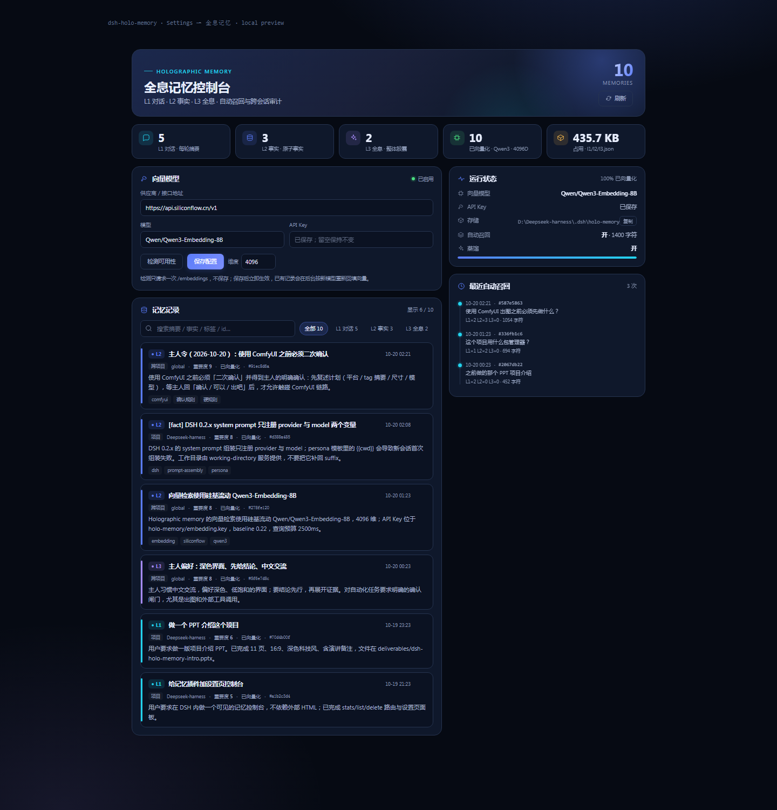
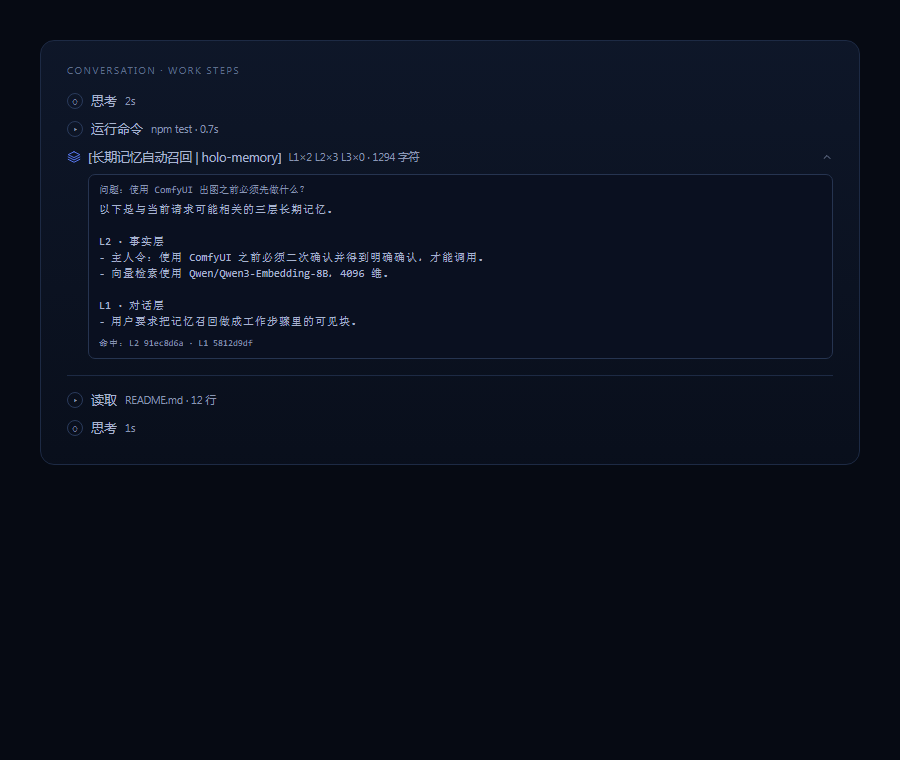

# dsh-holo-memory

> GitHub: <https://github.com/Kaede0757-sudo/dsh-holo-memory>

三层全息记忆插件，为 [DeepSeek Harness](https://github.com/deepseek-ai/deepseek-harness)（dsh）补上跨会话长期记忆：

- **L1 对话层**：每次对话结束，把这一轮蒸馏成一条紧凑摘要（用户要什么、做了什么、结果）。
- **L2 事实层**：从对话里抽出原子事实（偏好、决策、约定、关键实体、待办、纠正），带 scope / tags / confidence / 出处。
- **L3 全息记忆层**：把多轮对话压缩成“部分包含整体”的整体胶囊（用户画像、项目状态、长期线索、未闭环事项）。一条 L3 就能让新会话回忆起整段关系的轮廓。

每个新的用户回合，插件会按当前问题从 L1/L2/L3 混合召回最相关的记忆，压缩进一个受预算约束的 `holo-memory` 上下文块，自动注入到该回合。检索使用三条独立排名通道做 RRF 融合：

1. **BM25 + 中文 bigram**：零依赖、永远可用；
2. **字符 2/3-gram**：中文子串、错字、中英混合时补位；
3. **可选的向量模型**：任何 OpenAI 兼容的 `/embeddings` 端点（OpenAI、Ollama、火山方舟等），开启后按校准后的余弦排名参与 RRF。

RRF 之后还会：
- 用 **Active Window** 主动补 1–2 条高重要度 L2 / L3（不依赖当前问题，预算单独保留）；
- 按 `IMMEDIATE / WORKING / BACKGROUND` 分配字符预算；
- 每条注入行带 `(id:xxxxxxxx)`；回答里引用过的 id 会在下一轮回写 `citedCount`，获得轻微加权。

纯本地存储，无服务端、无账号、无遥测。

---

## 安装（桌面版 / 本地开发）

本仓库是插件源码。先 build：

```sh
npm install
npm run build     # tsc -> lib/
```

桌面版（Electron）的 profile 由应用独占管理，命令行 `dsh plugin --profile desktop add …` 会被拒绝。请走应用内入口：

1. 打开 **设置 → 插件 → 添加插件**；
2. 「包名或地址」填本地目录：`D:\path\to\dsh-holo-memory`；
3. 安装完成后重启 dsh（工具只在启动时注册）；重启后开新会话，说「记住：这个项目用 pnpm」验证。

非桌面 profile 也可以用 CLI：

```sh
dsh plugin --profile web add link:/absolute/path/to/dsh-holo-memory
```

卸载 / 回滚：在设置 → 插件里卸载，或从 profile 的 `package.json` 的 `dsh.profile.bundles` 和 `dependencies` 里删除 `dsh-holo-memory`，再 `pnpm install` 并重启。

---

## 全息记忆页面（新）



安装/重载后，侧边栏会出现 **全息记忆** 一级入口（在设置上方，和「插件」并列）。点击后进入独立的记忆页面，不再是设置里的一段：

- 顶部总记忆数 + L1/L2/L3/已向量化/占用空间；
- **向量模型配置**：供应商 / 接口地址、模型、API Key、可选维度；
  - 「检测可用性」只发一次 `/embeddings` 探测：判断是否可达、是不是 embedding 模型、返回维度与延迟，**不保存**；
  - 「保存配置」写入 `embedding.json` + `embedding.key`，立即生效，并后台按新模型重新回填已有记录；
- 存储路径、embedding 模型与状态、蒸馏开关；
- 搜索框、按层筛选（全部 / L1 / L2 / L3）；
- 每条记忆的层、scope、项目、重要度、向量状态、时间、正文（可展开），以及删除按钮；
- **最近自动召回**：每次注入的时间、session id、查询、L1/L2/L3 条数、注入字符数和命中的记录 id；
- 删除立即落盘，并刷新统计。

其他用户不需要改 YAML：打开控制台填自己的接口、模型、Key，点「检测可用性」确认是向量模型，再保存即可。API Key 永远不通过 GET 返回，也不会写进 `embedding.json`。

控制台由 host 半的读写路由提供，数据来自 `$DSH_HOME/holo-memory/*.json`，不依赖外部 HTML 或网络资源。修改类请求需要 `x-holo-memory: 1` 请求头，防止跨站触发。

### 怎么确认“别的会话”真的用了记忆

1. 新开一个会话，问一个只有记忆里才有答案的问题（例如“使用 ComfyUI 出图前必须先做什么？”）；
2. 工作步骤里会出现 `[长期记忆自动召回 | holo-memory]` 行，展开可以看到问题、召回正文和命中的记录 id；
3. 打开侧边栏 **全息记忆 → 最近自动召回**，刷新，应该出现一条 **session id 与当前会话不同** 的记录，包含 query、L1/L2/L3 数量、命中的 id；
4. 也可以直接让 agent 调用 `memory_injections`，返回同样的审计列表。

审计写入 `$DSH_HOME/holo-memory/injections.jsonl`（只保留最近 1000 条 / 1 MB）。它记录的是“注入事实”，不是“记忆库存”；所以它能证明别的会话确实收到了记忆。

## 工作步骤里的召回可视化



每次自动召回都会带一条 `kind: "holo-memory"` 的上下文消息；Web 客户端用一个 context 节点渲染器把它投影成聊天气泡工作步骤里的一行，和「思考 / 运行命令 / 读取」同一层级：

- 折叠：显示 `[长期记忆自动召回 | holo-memory]` + `L1×n L2×n L3×n · 字符数`；
- 展开：显示触发问题、去掉了标题行的召回正文、命中记录 id；
- 原生的其他 context 行（skill catalog、instructions 等）仍交给 DSH 原来的渲染器，不改变行为。

> client 半是这次新增的；如果侧边栏暂时看不到「全息记忆」或工作步骤里没有召回行，**刷新一次页面**；仍没有就重启 dsh。

---

## 配置

默认配置全部可用。需要覆盖时，在你的 profile patch（`~/.dsh/profiles/desktop/cordis.patch.yml`）里按 id 覆盖：

```yaml
- id: holo-memory
  config:
    injectMaxChars: 1200
    extractMaxTokens: 1400
    # 可选：开启向量检索（OpenAI 兼容 /embeddings）
    embeddingEnabled: true
    embeddingBaseUrl: https://api.siliconflow.cn/v1
    embeddingModel: Qwen/Qwen3-Embedding-8B
    embeddingApiKeyFile: D:/path/to/DSH_HOME/holo-memory/embedding.key
    embeddingBaseline: 0.22
```

API Key 推荐放在单独文件（首行），而不是写进 YAML；插件会优先读环境变量，再读 `embeddingApiKeyFile`。SiliconFlow 的 Qwen3-Embedding-8B 输出 4096 维，查询耗时约 200–400ms。

### 常用字段

| 字段 | 默认 | 说明 |
|---|---|---|
| `storageDir` | `$DSH_HOME/holo-memory` | 记忆根目录 |
| `maxL1/maxL2/maxL3` | 2000/3000/300 | 各层记录上限，超出按重要度/时间淘汰 |
| `injectEnabled` | `true` | 每轮是否自动召回注入 |
| `injectMaxChars` | `1400` | 注入块字符预算 |
| `injectMinScore` | `0.12` | 召回阈值，低于不注入 |
| `injectL1/L2/L3` | 2/5/3 | 每层最多注入条数 |
| `injectSubagents` | `false` | 是否为子代理会话注入 |
| `activeWindowEnabled` | `true` | 是否主动补位高重要度 L2/L3 |
| `activeWindowMaxItems` | `2` | 主动补位最多几条 |
| `activeWindowMaxChars` | `420` | 主动补位的字符上限（优先保留） |
| `activeWindowMinImportance` | `7` | 进入主动补位的最低重要度（≥8 的事实不受 kind 限制） |
| `rrfRankConstant` | `60` | RRF 的 k 值 |
| `extractEnabled` | `true` | 回合结束是否蒸馏 |
| `extractProvider/extractModel` | `''` | 蒸馏用模型；留空跟随当前会话的 provider/model |
| `extractMaxTokens` | `1400` | 蒸馏输出上限 |
| `extractMinTurnChars` | `60` | 太短的回合不蒸馏 |
| `extractMaxTranscriptChars` | `12000` | 喂给蒸馏模型的对话上限 |
| `embeddingEnabled` | `false` | 是否启用向量检索 |
| `embeddingBaseUrl` | `''` | 例：`http://127.0.0.1:11434/v1`、`https://ark.cn-beijing.volces.com/api/v3` |
| `embeddingModel` | `''` | 例：`nomic-embed-text`、`doubao-embedding-*` |
| `embeddingApiKeyEnv` | `DSH_HOLO_EMBEDDING_API_KEY` | 从这个环境变量读取 API Key；本地 Ollama 可留空 |
| `embeddingApiKeyFile` | `''` | 从文件首行读取 API Key（优先于环境变量之后的回退；建议 0600 权限） |
| `embeddingDimensions` | `0` | 0 = 用端点默认维度 |
| `embeddingBaseline` | `0.22` | 向量模型的“无关文本”余弦基线，低于它按噪声处理；换模型可微调 |
| `queryEmbeddingTimeoutMs` | `1200` | 查询向量预算，超时退回词法 |
| `debug` | `false` | 输出插件诊断日志 |

> 向量模型是可选项：不开启时插件完全靠 BM25+中文 bigram 工作，零网络依赖。开启后新写入记录会在后台分批补齐向量，查询时实时算一次问题向量。

---

## 数据布局

```
$DSH_HOME/holo-memory/
├── l1.json   # 每轮对话摘要
├── l2.json   # 原子事实
└── l3.json   # 全息记忆胶囊
```

全部是普通 JSON，可读、可 diff、可手工编辑；每条记录都带 `scope`（`user` 跨项目 / `project` 当前工作区）、`projectKey`、时间戳、重要度和来源会话。写入是原子的（临时文件 + rename），不会写坏半截文件。

---

## 模型工具

| 工具 | 用途 |
|---|---|
| `memory_recall(query, layers?, limit?)` | 混合检索三层记忆，返回带 id 的记录 |
| `memory_note(text, layer?, scope?, title?, tags?, importance?)` | 主动写入 L2 事实或 L3 胶囊 |
| `memory_list(layer?, limit?)` | 按时间列出某一层记忆 |
| `memory_forget(id)` | 按 id（或 8 位后缀）删除过时/错误的记忆 |
| `memory_injections(limit?)` | 最近自动召回审计：session id、query、层条数、命中 id |
| `memory_stats()` | 各层数量、向量覆盖、存储路径、蒸馏状态 |

另外插件会注册一段很短的静态 guidance，告诉模型“你有三层长期记忆，可以主动 recall/note/forget”。

---

## 工作方式

1. **记录**：监听 `session/event` 的 `turn/start`、`user/message`、`assistant/message`、`turn/end`，把当前回合的对话文本收集到内存缓冲区（有长度上限）。
2. **蒸馏**：`turn/end` 后异步调用一次模型（复用当前会话的 provider/model，或配置覆盖），要求输出严格 JSON：`l1`、`l2[]`、`l3[]`。解析失败/没有模型时退化为确定性的 L1 摘要，所以“记录对话”永远不会因为模型不可用而丢失。
3. **合并**：L2 做近似去重（同 scope 内相近事实更新而非追加）；L3 按 id/标题更新已有胶囊或新建；所有写入带出处（session/turn）。
4. **召回**：`agent/pre-step` 里拿到本轮的新用户消息，先 `next()` 让其他插件处理，再按问题跑词法 / 字符 n-gram / 向量三通道排名，RRF 融合；命中后额外补 1–2 条高重要度 resident 记忆（Active Window），并按字符预算和 band 裁剪。若 query 完全没有命中，只要 Active Window 有高重要度记忆，也会注入这些背景；两者都空时不产生 token。短问题（如“继续”）退化为最近/最重要的 L1+L3 快照。
5. **注入**：作为一条 user-role snapshot 消息插入本步，带 `source.kind = "holo-memory"`，并在后续回合作为普通历史保留；不会被再次计入 L1 捕获。

---

## 边界与已知限制

- 蒸馏是“回合结束后的后台调用”：桌面端常驻时可靠；headless 一次性任务在进程退出时可能来不及跑完最后一条蒸馏（会留下上一轮的 L1，不影响已有记忆）。
- 记忆是本地明文 JSON；不要把密钥写进对话。插件在 L2/L3 写入前做了基本的密钥模式拦截，但不能替代你的判断。
- L2 去重是词法近似（Jaccard）；开启向量后只影响召回，不影响写入去重。
- 控制台只展示元数据与文本，不展示 4096 维原始向量；需要调试向量时用 `memory_stats` 看覆盖率。
- 与其它注册 `memory_*` 工具的插件同时安装可能撞名，建议只保留一个记忆插件。

## 文档与演示

- 项目介绍 PPT：[docs/dsh-holo-memory-intro.pptx](docs/dsh-holo-memory-intro.pptx)（11 页，16:9，含演讲备注）
- 生成脚本与背景素材：[docs/ppt/](docs/ppt/)
- 测试：`npm test`（18 项）

## License

MIT
