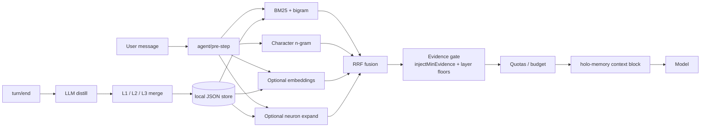
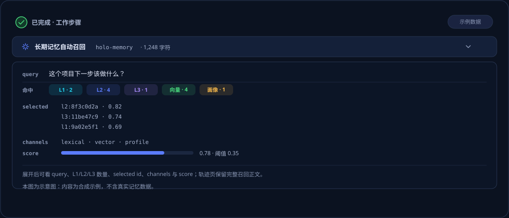
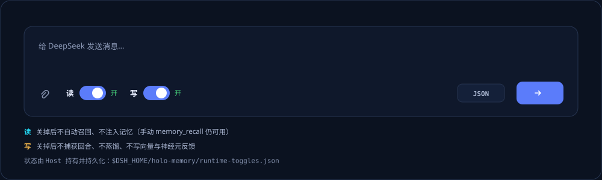
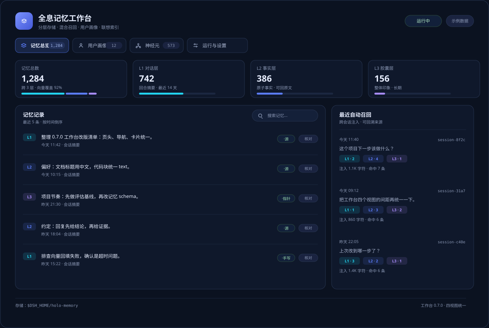

# dsh-holo-memory

[](CHANGELOG.md)
[](test/)
[](LICENSE)
[](https://github.com/deepseek-ai/deepseek-harness)

> **Auditable three-layer long-term memory for DeepSeek Harness.**  
> L1 dialogue summaries · L2 atomic facts · L3 holographic capsules · user-profile preferences/habits/personality · hybrid recall · neuron index · source pointers · local-first JSON.

`dsh-holo-memory` 是一个给 [DeepSeek Harness](https://github.com/deepseek-ai/deepseek-harness)（DSH）使用的长期记忆插件。它不在模型权重里“记住”，也不把完整聊天记录硬塞回上下文；它在本地维护一本可检索、可核对、可修订的记忆账本，并在每一轮只注入和当前问题真正相关的一小段。

- 仓库：<https://github.com/Kaede-Ayaki/dsh-holo-memory>
- 当前版本：`0.7.0`（2026-11-24）
- 更新日志：[CHANGELOG.md](CHANGELOG.md)
- 伴侣插件：[neuron-memory/](neuron-memory/)（`dsh-neuron-memory`）
- 界面预览：[docs/preview/](docs/preview/) —— 手工绘制的矢量示意图（示例数据）
- 在线演示：[GitHub Pages 静态演示](https://kaede-ayaki.github.io/dsh-holo-memory/demo/) —— 可点击的四视图，合成示例数据

> 本仓库**不发布任何真实截图**：截图会暴露作者本机的记忆内容。所有界面预览都是 `docs/preview/` 里用 SVG 手工绘制的示意图，内容是合成的示例数据，不含真实记忆。

---

## 目录

- [为什么需要它](#为什么需要它)
- [核心特性](#核心特性)
- [用户画像：偏好、习惯与人格](#用户画像偏好习惯与人格)
- [架构](#架构)
- [安装](#安装)
- [快速验证](#快速验证)
- [配置](#配置)
- [记忆模型与存储](#记忆模型与存储)
- [召回机制](#召回机制)
- [来源、证据与修订](#来源证据与修订)
- [工作步骤可视化](#工作步骤可视化)
- [输入框双开关（读取 / 写入）](#输入框双开关读取--写入)
- [控制台](#控制台)
- [模型工具](#模型工具)
- [神经元记忆](#神经元记忆)
- [每日维护](#每日维护)
- [热更新与 HMR](#热更新与-hmr)
- [测试](#测试)
- [边界与安全](#边界与安全)
- [版本与路线](#版本与路线)
- [License](#license)

---

## 为什么需要它

模型的权重是静态的，上下文窗口是有限的；跨会话的事实、偏好、项目状态和未闭环事项，需要一个外部账本。

dsh-holo-memory 把“记住”拆成三个动作：

1. **分层收纳**——过程、事实、整体印象分开存；
2. **按需召回**——每一轮只取当前问题相关的一小段；
3. **可回取原文**——需要核对时，回到 source 指针，而不是靠模型补一个像样的答案。

它不追求“记得越多越好”。默认策略是**精度优先**：弱相关宁可不注入，也不拿一堆高重要度但离题的记忆污染上下文。

---

## 核心特性

### 三层记忆

| 层 | 内容 | 典型用途 |
|---|---|---|
| **L1 对话层** | 每轮对话的紧凑摘要：用户要什么、做了什么、结果 | 找回“上次聊到哪了” |
| **L2 事实层** | 原子事实：偏好、决策、约定、实体、待办、纠正 | 跨会话复用确定事实 |
| **L3 全息层** | 多轮压缩的整体胶囊：用户画像、项目状态、长期线索、未闭环事项 | 新会话快速恢复关系轮廓 |

### 用户画像：偏好、习惯与人格

用户画像不是第四层事实库，而是从 L1/L2/L3 中**蒸馏出来的用户侧画像**，保存在独立的 `a.json`，证据仍指回原记录。

| 字段 | 内容 |
|---|---|
| `preferences` | 稳定喜好偏向（交付形态、语言、风格、工具选择等） |
| `habits` | 行为习惯（先给结论、先确认现状、围栏交付等） |
| `personality` | 人格与工作方式（直接/务实、重视可验证结果等） |
| `workingStyle` | 高频工作流关键词 |
| `confirmFor` | 必须咨询用户的抉择类型：不可逆、公开发布、付费、安全/隐私、关系边界等 |

每轮注入会在 L1-L3 召回块后追加一个紧凑的 `[用户画像 · 偏好/习惯/人格]` 块：

- **低风险、可逆、日常事项**：默认按 A 的偏好和习惯直接执行，不再反复问；
- **重要、不可逆、涉及付费/公开发布/安全隐私/关系边界**：必须先咨询用户，不能拿 A 代替确认；
- 该边界同时写进系统提示词和 A 块，代码层不伪造“强制拦截”。

控制台「用户画像」页已与记忆总览、神经元、运行与设置统一为同一套工作台视觉。

### 四通道混合召回

1. **BM25 + 中文 bigram**：零依赖，永远可用；
2. **字符 2/3-gram**：中文子串、错字、中英混合时补位；
3. **向量检索**（可选）：任何 OpenAI 兼容 `/embeddings` 端点；
4. **神经元联想**（可选）：`memory ↔ entity` 双部图扩散候选，只给 holo id，不复制正文。

四路排名用 RRF 融合；融合后还有逐条证据闸门，避免“层里只有弱匹配时，弱匹配也被顶成第一名”。

### 本地、可读、可核对

- 纯本地 JSON，无服务端、无账号、无遥测；
- 每条记录带 `scope`、`projectKey`、重要度、`source`、`revision`；
- `·源` / `·指针` / `·手写` 证据等级；
- `memory_open(id)` 可回取原文片段、session/turn 指针、哈希校验与修订历史；
- 原子写入，不会写坏半截文件。

### 召回结果看得见

- 聊天「已完成」工作步骤里显示可折叠召回行；
- 轨迹页保留完整召回正文；
- 控制台有「最近自动召回」审计；
- `injections.jsonl` 可证明“别的会话真的收到了哪些 id”。

---

## 架构



### 写入路径

```text
turn/end
  → collect turn transcript
  → distill strict JSON (L1, L2[], L3[])
  → validate / dedupe / redact secrets
  → append or revise records
  → atomic JSON write
  → optional embedding backfill
  → optional neuron incremental sync
```

### 读取路径

```text
user message
  → tokenize / optional query embedding
  → four ranking channels
  → RRF fusion
  → per-record evidence gate
  → layer quotas
  → character budget trimming
  → user-role snapshot with source tags
```

---

## 安装

### 前置条件

- DSH 桌面版或兼容的 DSH profile；
- Node.js `>= 22.19`（构建时）；
- 可选：一个 OpenAI 兼容的 embedding 端点（不开启也能用词法召回）。

### 1. 构建

```sh
git clone https://github.com/Kaede-Ayaki/dsh-holo-memory.git
cd dsh-holo-memory
npm install
npm run build
npm test
```

构建产物在 `lib/`；客户端入口在 `client/client.js`。

### 2. 安装到桌面版

DSH 桌面版的 profile 由应用独占管理；推荐走应用内入口：

1. 打开 **设置 → 插件 → 添加插件**；
2. 「包名或地址」填本地目录，例如 `D:\path\to\dsh-holo-memory`；
3. 安装完成后**重启 DSH**（未启用 HMR 时工具只在启动时注册）；
4. 新开一个会话，说“记住：这个项目用 pnpm”验证写入。

非桌面 profile 也可以用 CLI：

```sh
dsh plugin --profile <profile> add link:/absolute/path/to/dsh-holo-memory
```

### 3. 可选：安装神经元伴侣

```sh
cd neuron-memory
npm install
npm run build
npm test
```

然后在同一个 DSH profile 里安装 `neuron-memory` 目录。  
边界：neuron 只提供联想候选 id，**不自己注入上下文**；正文仍由 holo 读取。

### 卸载 / 回滚

在 **设置 → 插件** 里卸载，或从 profile 的 `package.json` 中移除：

- `dsh.profile.bundles` 里的 `dsh-holo-memory`；
- `dependencies` 里的 `dsh-holo-memory`。

再执行 `pnpm install` 并重启。记忆数据在 `$DSH_HOME/holo-memory`，卸载插件不会自动删除数据。

---

## 快速验证

### 1. 工具是否注册

新会话里让 agent 调：

```text
memory_stats()
```

应返回 L1/L2/L3 数量、来源覆盖、向量覆盖、存储路径和阈值。

### 2. 跨会话是否真的召回

1. 在会话 A 说一个明确事实，例如“以后这个项目用 pnpm test”；
2. 等回合结束后开会话 B，问“这个项目跑测试用什么命令？”；
3. 工作步骤里应出现：

```text
长期记忆自动召回 | holo-memory · N 字符
```

4. 打开侧边栏 **全息记忆 → 最近自动召回**，应看到一条 session id 与当前会话不同的审计记录；
5. 也可以调 `memory_injections(limit=10)` 查看审计。

### 3. 召回不对怎么办

- 先看 `memory_injections`：是 query 错了、记录错了，还是根本没召回；
- 用 `memory_recall(query)` 手动检查候选；
- 用 `memory_open(id)` 核对原文和 source；
- 用 `memory_forget(id)` 删掉错误/过期记录；
- 用 `memory_doctor(deep=true)` 检查存储、来源、向量、审计和阈值。

---

## 配置

默认配置开箱可用。需要覆盖时，在 profile 的 `cordis.patch.yml` 里按 id 覆盖：

```yaml
- id: holo-memory
  config:
    injectEnabled: true
    injectMaxChars: 5000
    injectMinEvidence: 0.44
    activeWindowFallbackOnly: true
    # 可选：向量召回
    embeddingEnabled: true
    embeddingBaseUrl: https://api.siliconflow.cn/v1
    embeddingModel: Qwen/Qwen3-Embedding-8B
    embeddingApiKeyFile: D:/path/to/DSH_HOME/holo-memory/embedding.key
    embeddingBaseline: 0.22
```

API Key 推荐放在单独文件（首行），不要写进 YAML；也可以使用环境变量 `DSH_HOLO_EMBEDDING_API_KEY`。

### 召回与注入

| 字段 | 默认 | 说明 |
|---|---:|---|
| `injectEnabled` | `true` | 是否每轮自动召回注入 |
| `injectMaxChars` | `1400` | 注入块字符预算；生产环境可按需提高，但不要把它当目标 |
| `injectMinScore` | `0.12` | 候选进入 RRF 的弱阈值 |
| `injectMinEvidence` | `0.44` | 逐条证据下限；低于它的候选不进入 RRF |
| `injectL1/L2/L3` | `2/5/3` | 每层最多注入条数；是上限，不再强行填满 |
| `injectSubagents` | `false` | 是否给子代理会话注入 |
| `activeWindowEnabled` | `true` | 是否允许 Active Window 兜底 |
| `activeWindowFallbackOnly` | `true` | 有 query 命中时不追加常驻记忆；`false` 恢复旧行为 |
| `activeWindowMaxItems` | `2` | 兜底最多几条 |
| `activeWindowMaxChars` | `420` | 兜底字符上限 |
| `activeWindowMinImportance` | `7` | 进入兜底的最低重要度 |
| `rrfRankConstant` | `60` | RRF 的 k 值 |
| `aSeriesEnabled` | `true` | 是否启用用户画像蒸馏与注入 |
| `aSeriesMaxChars` | `800` | A 块字符预算 |
| `aSeriesRefreshOnExtract` | `true` | 每轮蒸馏后刷新 A 画像 |

### 存储与容量

| 字段 | 默认 | 说明 |
|---|---:|---|
| `storageDir` | `$DSH_HOME/holo-memory` | 记忆根目录 |
| `maxL1/maxL2/maxL3` | `2000/3000/300` | 各层活跃记录上限 |
| `sourceExcerptMaxChars` | `1600` | 每条来源指针保存的逐字片段上限 |

### 蒸馏

| 字段 | 默认 | 说明 |
|---|---:|---|
| `extractEnabled` | `true` | `turn/end` 后是否蒸馏 |
| `extractProvider/extractModel` | `''` | 留空跟随当前会话的 provider/model |
| `extractMaxTokens` | `1400` | 蒸馏输出上限 |
| `extractMinTurnChars` | `60` | 太短的回合不蒸馏 |
| `extractMaxTranscriptChars` | `12000` | 喂给蒸馏模型的对话上限 |
| `extractTemperature` | `0.2` | 蒸馏温度 |

### 向量

| 字段 | 默认 | 说明 |
|---|---:|---|
| `embeddingEnabled` | `false` | 是否启用向量召回 |
| `embeddingBaseUrl` | `''` | OpenAI 兼容端点，例如 `http://127.0.0.1:11434/v1` |
| `embeddingModel` | `''` | 例如 `nomic-embed-text`、`Qwen/Qwen3-Embedding-8B` |
| `embeddingApiKeyEnv` | `DSH_HOLO_EMBEDDING_API_KEY` | 环境变量形式的 Key |
| `embeddingApiKeyFile` | `''` | 文件首行读取 Key，权限建议 0600 |
| `embeddingDimensions` | `0` | 0 = 使用端点默认维度 |
| `embeddingBaseline` | `0.22` | 无关文本的余弦基线；换模型可重新校准 |
| `embeddingBatchSize` | `8` | 后台回填批大小 |
| `queryEmbeddingTimeoutMs` | `1200` | 查询向量预算；超时退回词法召回 |

### 维护与诊断

| 字段 | 默认 | 说明 |
|---|---:|---|
| `maintenanceEnabled` | `true` | 是否启用每日维护 |
| `maintenanceHour/maintenanceMinute` | `4/30` | 本地维护时间 |
| `l1ArchiveAfterDays` | `14` | L1 超过此天数且重要度低于保留阈值时归档 |
| `l1ArchiveKeepImportance` | `8` | 达到此重要度的 L1 保留到硬上限 |
| `l1ArchiveMaxDays` | `60` | 超过此天数的 L1 无论重要度都归档 |
| `debug` | `false` | 输出插件诊断日志 |

> 向量是可选项。不开启时插件完全靠 BM25 + 中文 bigram 工作，零网络依赖。

---

## 记忆模型与存储

### 记录字段

所有记录共享：

- `scope`：`user`（跨项目）或 `project`（当前工作区）；
- `projectKey` / `projectLabel`；
- `importance`（0–10）；
- `source`：session / turn / seq / 逐字片段 / 哈希；
- `revision` + `history`：更新时保留旧快照；
- `createdAt` / `updatedAt` / `hash` / 可选 `embedding`。

### 目录布局

```text
$DSH_HOME/holo-memory/
├── l1.json                 # 对话摘要（活跃集）
├── l2.json                 # 原子事实
├── l3.json                 # 全息胶囊
├── embedding.json          # 向量端点配置（不含 Key）
├── embedding.key           # 可选：本地 Key 文件
├── injections.jsonl        # 最近自动召回审计
├── runtime-toggles.json    # 读取/写入双开关状态
├── maintenance.json        # 上次维护时间与归档数
├── archive/
│   └── l1-YYYY-MM.jsonl    # 已归档 L1，只追加
└── backups/                # 关键操作前备份
```

全部是普通 JSON/JSONL：可读、可 diff、可备份、可人工修复。写入使用临时文件 + rename，避免半截文件。

---

## 召回机制

### 1. 四通道候选

- **BM25**：词项匹配，零依赖；
- **字符 n-gram**：中文子串、错字、中英混合；
- **向量**：开启后按 baseline 校准的 cosine；
- **neuron**：双部图扩散得到的 holo id。

### 2. RRF 融合

每个通道内部排名，RRF 融合；相同内容哈希共享 rank，避免重复记录刷榜。

### 3. 证据闸门（# 神经元伴侣）

层内相对分不能单独决定注入。每条候选还要过绝对证据下限：

| 层 / 类型 | 默认下限 |
|---|---:|
| L1 对话摘要 | `0.50` |
| L2 decision / task / entity | `0.50` |
| L2 fact / preference / correction | `0.55` |
| L2 的 curated tag 命中 query | 回落到 `0.44` |
| L3 全息胶囊 | `0.44` |

这解决的是：

- 高重要度规则每轮无条件出现；
- 层内只有弱匹配时，弱匹配被归一化成 `1.000`；
- 泛词（任务、目标、内容、风格、给我）把提示词/交付规则误召回。

### 4. Active Window 只做兜底

- 有任意 query 命中 → 不追加常驻记忆；
- 完全无命中 → 才补 1–2 条高重要度 L2/L3；
- 可在配置里设 `activeWindowFallbackOnly: false` 恢复旧的全量常驻行为。

### 5. 预算与配额

候选先按层配额，再按 `IMMEDIATE / WORKING / BACKGROUND` 和字符预算裁剪。  
配额是**上限**，不是必须填满；没有足够强的候选时宁可少注入。

---

## 来源、证据与修订

### 证据等级

- `·源`：有逐字原文片段；`memory_open` 可看，哈希可校验；
- `·指针`：只有 session / turn / seq 指针，没有保存原文；
- `·手写`：`memory_note` 手动写入；
- 无标记：只有摘要，不要在没有 `memory_open` 校验时当原文引用。

### memory_open

```text
memory_open(id, maxChars?, history?)
```

返回：

- 记录正文；
- source 指针与逐字 excerpt；
- `excerptHash`；
- revision / history；
- 若没有原文，明确说明 `source unavailable`，绝不编造位置。

### 修订

更新记录会递增 `revision`，旧快照进入 `history`（最多 20 条）。  
“修正”不是静默覆盖；你能看到改过什么。

---

## 工作步骤可视化



当前版本在聊天「已完成」工作步骤里显示折叠行：

- 聊天「已完成」工作步骤里出现可折叠召回行：
  `长期记忆自动召回 | holo-memory · N 字符`
- 轨迹页保留完整召回正文；
- 展开后可看 query、L1/L2/L3 数量、selected id、channels、score；
- 原生的其他 context 行（skill catalog、instructions 等）仍交给 DSH 原来的渲染器。

> 预览为矢量示意图，内容是合成示例；仓库不发布真实截图。

> 如果侧边栏看不到「全息记忆」，或工作步骤没有召回行：先**刷新页面**；仍没有再重启 DSH。

---

## 输入框双开关（读取 / 写入）



输入框工具行、JSON 复制按钮旁边有两个默认打开的开关：

| 按钮 | 默认 | 关闭后的效果 |
|---|---|---|
| **读** | 开 | 不自动召回、不注入记忆；模型只看到普通上下文。显式 `memory_recall` / `memory_open` 等手动工具仍可自己调用（只有 agent 主动读才会读） |
| **写** | 开 | 不捕获回合、不蒸馏、不新增/修改/删除记忆、不写 embedding/neuron 反馈；`memory_note` / `memory_forget` / 非 dry-run `memory_maintenance` 也返回禁用提示 |

状态由 Host 持有并持久化到：

```text
$DSH_HOME/holo-memory/runtime-toggles.json
```

默认 `{ "read": true, "write": true }`；按钮点击后立即生效，不需要重启。  
刷页面或重开窗口会从 Host 重新读取；多个窗口以 Host 状态为准。

对应 API：

```text
GET  /holo-memory/toggles
POST /holo-memory/toggles   { "read": false } 或 { "write": false }
```

POST 需要 `x-holo-memory: 1` 请求头。

---

## 控制台

0.7.0 起工作台统一为「记忆总览 / 用户画像 / 神经元 / 运行与设置」四个视图，共用页头、导航、状态胶囊、卡片与间距。



> 预览为矢量示意图（示例数据），不是真实截图；仓库不发布真实截图。

安装后侧边栏会出现 **全息记忆** 一级入口：

- 总记忆数、L1/L2/L3 数量、向量覆盖率、占用空间；
- **向量模型配置**：
  - 供应商 / 接口地址、模型、API Key、可选维度；
  - 「检测可用性」发一次 `/embeddings` 探测，不保存；
  - 「保存配置」写入 `embedding.json` + `embedding.key`，后台回填已有记录；
- 证据链覆盖率、最近修订数；
- **记忆体检**：来源覆盖、哈希、向量、重复、审计、阈值；深检会真打开原文并跑召回探针；
- 搜索、按层筛选、查看正文、删除；
- **最近自动召回**：时间、session id、query、L1/L2/L3 数量、注入字符数、命中 id；
- 删除立即落盘并刷新统计。

控制台数据来自 host 侧路由，不需要外部 HTML 或 CDN。API Key 永远不会通过 GET 返回，也不会写进 `embedding.json`。

### 控制台 API

```text
GET  /holo-memory/stats
GET  /holo-memory/list?layer=l1|l2|l3|all&limit=N
GET  /holo-memory/neuron
GET  /holo-memory/injections?limit=N
GET  /holo-memory/doctor?deep=1
GET  /holo-memory/open?id=<id>&limit=N&history=1
GET  /holo-memory/config
POST /holo-memory/config
GET  /holo-memory/toggles
POST /holo-memory/toggles
POST /holo-memory/test-embedding
POST /holo-memory/delete   { "id": "..." }
```

修改类请求需要 `x-holo-memory: 1` 请求头，防止跨站触发。

---

## 模型工具

### holo 工具

| 工具 | 用途 |
|---|---|
| `memory_recall(query, layers?, limit?)` | 混合检索三层记忆，返回 id、证据标记和 score |
| `memory_open(id, maxChars?, history?)` | 回取原文片段、source 指针、哈希与修订历史 |
| `memory_note(text, layer?, scope?, title?, tags?, importance?)` | 主动写入 L2 事实或 L3 胶囊 |
| `memory_list(layer?, limit?)` | 按时间列出某一层 |
| `memory_forget(id)` | 删除过时/错误记录 |
| `memory_injections(limit?)` | 最近自动召回审计 |
| `memory_stats()` | 数量、覆盖率、存储路径、蒸馏状态、阈值 |
| `memory_doctor(deep?)` | 记忆体检；deep 会真打开原文并跑召回探针 |
| `memory_maintenance(olderThanDays?, dryRun?)` | 手动运行维护/归档预览 |
| `memory_profile(refresh?)` | 读取用户画像；refresh=true 时从当前 L1/L2/L3 重新蒸馏 |

### neuron 工具

| 工具 | 用途 |
|---|---|
| `neuron_ingest(rebuild?)` | 从 holo 服务或只读 JSON 增量同步图 |
| `neuron_expand(query?, seedIds?, depth?, topK?)` | 扩散激活，返回候选 holo id |
| `neuron_stats()` | 节点/边/度数统计 |

> neuron 只返回 id 和 activation；正文仍要 `memory_recall` / `memory_open` 回 holo 取。

---

## 神经元记忆

`neuron-memory/` 是同一仓库中的可选伴侣插件 `dsh-neuron-memory`。

```text
memory 节点  m:<holoId>
  holoId / layer / label / tags / importance

entity 节点  e:<normalized entity>
  label / degree

边  memory --mentions--> entity
  weight / fireCount
```

- 记忆之间没有直接边，联想必须经过共享实体；
- 只读 holo 记录，不复制 canonical 正文；
- 扩散激活：`depth` / `damping` / `minSignal` / `topK`；
- **项目隔离**：memory 节点带 `projectKey`，holo 自动扩展只取当前 project + user-scoped；
- **查询词重叠闸门**：自动扩展要求候选 label/tags 与 query 有 salient 词重叠；显式 seedIds 例外；
- 增量 sync、度数剪枝、引用反馈；
- holo 不在时自动退化为纯 holo 召回。

控制台的 **神经元记忆** 子页面展示节点/边/平均度数、层级分布和 Top 实体。

安装与详细边界见 [neuron-memory/README.md](neuron-memory/README.md)。

neuron 0.1.3 起会在建图时清洗 Markdown/HTML/JSON 标签污染；升级后需执行一次 `neuron_ingest(rebuild=true)`。

---

## 每日维护

宿主启动后读取 `maintenance.json`：

- 每天本地 **04:30** 运行一次；
- 上次维护超过 20 小时（或从未运行）→ 启动约 30 秒后补跑；
- 归档条件：
  - L1 超过 14 天且重要度低于 8；
  - 或超过 60 天，无论重要度；
- 顺序：先追加 `archive/l1-YYYY-MM.jsonl`，再从活跃 `l1.json` 移除；
- L2 / L3 不走此归档流程；
- `memory_maintenance(dryRun=true)` 可预览；
- `memory_doctor` 会检查最近维护时间。

---

## 热更新与 HMR

DSH 自带 `@deepseek-ai/dsh-hmr`。桌面版 profile 通常已经启用；如果当前 profile 的 `hmr` 条目处于 active，改配置/改代码可以走官方热重载，而不是重启 Host。

### 配置热更新

修改 profile 的 `cordis.patch.yml` 即可触发配置重组合：

```yaml
- id: holo-memory
  config:
    injectMinEvidence: 0.44
    activeWindowFallbackOnly: true
```

### 服务端代码热更新

让 HMR 监听插件源码/构建输出，并重新导入 `lib/`：

```yaml
- id: hmr
  disabled: false
  config:
    root:
      - "D:/path/to/dsh-holo-memory"
```

流程：

```text
改 src/*.ts
→ npm run build
→ lib/*.js 变化
→ HMR 卸载旧插件 entry
→ 重新导入新 lib
→ 不重启 DSH
```

前提：插件必须 reload-safe——所有 timer / watcher / queue / observer 用 `ctx.effect` 或 disposer 释放；`apply` 幂等；持久状态只放 `$DSH_HOME/holo-memory`。

### 客户端热更新

服务端 HMR **不会自动替换浏览器已加载的 client module graph**。  
- 开发模式：`pnpm run dev:web` + client HMR；
- 生产模式：服务端 reload 后**刷新页面**加载新的 `client.js`，通常不需要重启 DSH Host。

### 限制

- HMR 依赖 Node loader 内部机制；`package.json` 单独变化不被检测；
- 替换失败会停掉旧插件，新插件 inactive，且不会自动回滚；需要健康检查和 Host 重启兜底；
- headless / SDK / ACP 默认可能禁用 HMR；packed worker 不暴露 Node module cache，代码替换不可用；
- 浏览器端仍是独立加载链路。

**没有 HMR 的环境**：改代码后重启 Host；或者采用“稳定 Host 插件 + 本地 sidecar 引擎”的架构，把可热更新的检索逻辑放到 sidecar。

---

## 测试

```sh
npm test
```

当前：

```text
holo:   43/43 PASS
neuron: 13/13 PASS
```

测试覆盖：

- L1/L2/L3 提取、JSON 解析失败降级；
- 来源指针、逐字 excerpt、哈希校验；
- 修订历史、删除、归档；
- 四通道召回、RRF、neuron 候选预留；
- 证据闸门、L2 标签闸门、Active Window 兜底；
- 任务 query 不携带无关提示词规则；显式规则 query 仍能召回；
- 控制台路由、体检、阈值合法性。

真实生产库回归（任务 query）：

```text
8acbbcab + 5106ddbd · 810 字符 · active=0
```

显式规则 / ComfyUI / 项目状态 query 仍能正常召回。

---

## 边界与安全

- 记忆是**本地明文 JSON**；不要把 API Key、密码、令牌写进对话；
- 写入前会做基础 secrets 模式拦截，但不能替代你的判断；
- 蒸馏是 `turn/end` 后的后台调用；headless 一次性任务退出时可能来不及跑最后一条；
- L2 去重是词法近似（Jaccard）；开启向量只影响召回，不影响写入去重；
- 与其它注册 `memory_*` 工具的插件同时安装可能撞名；建议只保留一个记忆插件；
- 来源缺失时明确标 `·指针` 或 `source unavailable`，不猜假位置；
- 控制台只展示元数据与文本，不展示 4096 维原始向量。

### 权威源

`dsh-holo-memory` 是自动 L1/L2/L3 记忆的唯一权威源。  
ALTM、内置记忆、笔记等只作只读参考；不要把同一条事实同时写进两个库（双重记账）。

---

## 版本与路线

- **0.6.0**：用户画像偏好/习惯/人格蒸馏；读取画像块；高风险抉择先咨询边界。
- **0.5.6**：移除全局 tools.register monkey-patch，修复工具 disposer 契约和预加载失败；保留自动读取/写入闸门。
- **0.5.5**：输入框读取/写入双开关；Host 持久化。
- **0.5.4**：神经元图项目隔离、查询词重叠过滤、种子去泛化、配置校验与 maxNodes 清理。
- **0.5.3**：召回相关性闸门；Active Window 兜底化；L2 标签/证据门控；回归测试。
- **0.5.2**：聊天工作步骤召回块；保持轨迹召回折叠行。
- **0.5.1**：工作步骤召回可视化修复；context renderer priority；轨迹兼容。
- **0.5.0**：神经元四通道、控制台神经元页、并发 graph 写修复。
- **0.4.x**：来源指针、memory_open、修订历史、每日维护、memory_doctor。

近期路线：

- **0.7.0**：用户画像命名统一 + 工作台视觉统一（当前版本）；
- **0.8.x**：检索评估基线、置信度 0.000–1.000 schema、时间有效性；
- **0.9.x**：冲突检测/解决、衰减与检索回归集；
- 继续观察证据闸门在长任务中的召回率/精确率；
- 增加 HMR 演练与 reload-safe 生命周期检查。

---

## 文档

- [CHANGELOG.md](CHANGELOG.md)
- [界面预览（SVG 示意图）](docs/preview/)
- [在线演示（GitHub Pages）](https://kaede-ayaki.github.io/dsh-holo-memory/demo/)
- [预览生成脚本](docs/preview/gen_previews.py)
- [检索评估基线（Phase 0）](eval/README.md)
- [Schema 迁移脚本（0.8，dry-run 默认）](scripts/migrate-0.8.mjs)
- [神经元伴侣 README](neuron-memory/README.md)
- [神经元伴侣召回相关性修复](CHANGELOG.md#053---2026-11-19)

> 介绍 PPT 与真实截图不再随仓库发布（两者都含本机记忆内容）。需要时在本地重新生成。

---

## License

MIT


